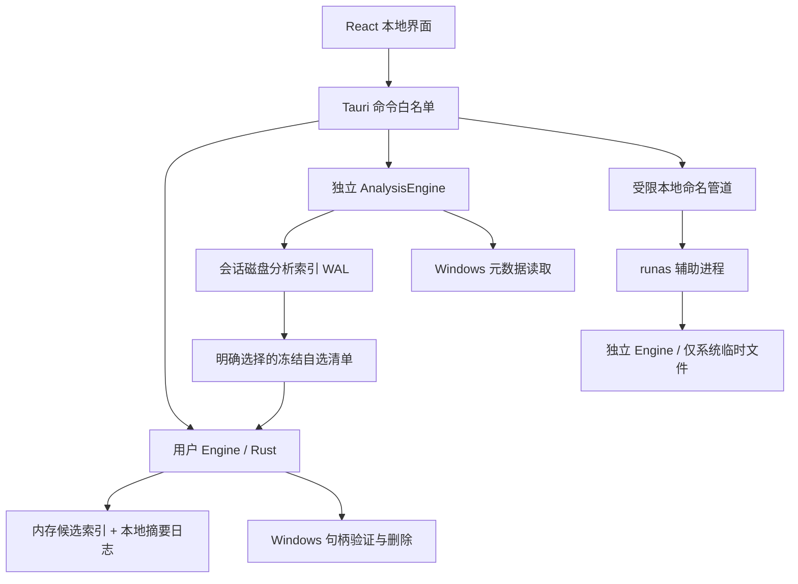

# 架构与安全边界

当前默认构建开放用户清理 Engine 和独立 AnalysisEngine（扫描阶段只读）。下图的命名管道与辅助进程分支由安装版的 `system-cleanup` feature 启用；免安装版不包含此能力。

应用扫描由封闭注册表声明 Known Folder 根和固定配置目录选择器。Windows 层先验证签名及安装身份，再按元数据检查已知数据布局；版本作为观察信息。配置只枚举指定层级，`Preferences` / `LocalPrefs.json` 只验证文件元数据。候选仍沿用路径、文件和应用身份复核。当前逐规则能力见编译能力摘要；证据 v3 和前端预览来自编译后目录，旧 v1/v2 目录冻结。

清理资格由 `cleanup_acceptance` 中的编译期记录与规则描述符共同决定，记录绑定规则 ID/版本和布局，应用样本版本保留为历史证据；当前安装按身份、组件、布局与格式核验。`Platform.cleanup_validated` 是后端接口，Engine 在准备和执行时调用；生产 Windows 平台只信任编译记录，在文件系统边界再次检查。仅 `cfg(test)` 平台可为内部创建的专用临时夹具模拟资格，任何 IPC、环境变量或配置均不能切换普通构建的权限。接口逐规则返回 `cleanup_versions` 与 `cleanup_block`，汇总字段只用于兼容说明。详见[本轮支持矩阵](support-matrix-cleanup-preparation.md)。

## 前端展示与业务边界

新版空间 UI 将原 App 的业务行为集中到 useAppController；页面和空间物件从同一控制层读取会话、选择、计划及报告。动画只表现状态，不发起业务调用。页面切换保留清理工作台与分析组件实例；展示偏好仅持久化模式、展开度和减少动画设置。自选来源扩展已有 IPC 和请求协调器；规则验收和历史数据库结构保持兼容。

## 数据流

`dustaway-core` 不依赖 Tauri、React 或 Windows，通过 `Platform` 接口提供扫描、应用状态检查、删除和空间读取。`dustaway-windows` 实现 Win32 边界，辅助进程和桌面程序复用核心但不共享可执行计划。

## 会话与计划

1. `start_scan` 只接受内置规则 ID，清空上次内存索引和计划；扫描线程每 128 个候选提交一个索引事务。
2. `list_candidates` 每页最多 200 项；界面虚拟渲染可见行。进度以 500 ms 间隔拉取，不编造扫描百分比。
3. `prepare_cleanup` 校验会话、范围、应用状态和排除项，把实际候选 ID 写入独立计划表。
4. `execute_cleanup` 只使用后端保存的计划 ID。即使前端改写展示的大小或路径，也无法扩大计划。旧计划在使用、重扫、清理范围设置变化或退出后失效；主题修改保持会话与计划。
5. 执行前逐项重新检查进程和文件状态。扫描后新增的文件从不自动进入计划。

UI 以完整计划数据展示确认窗口，但执行器只信任计划 ID。字节数跨 IPC 为十进制字符串，UI 使用 BigInt。实验模式中的普通用户与系统扫描分别有会话；默认版本所有系统请求在启动任务前被拒绝。UI 查询状态失败时禁止新的清理，并提供只读重查。

初版每个 Engine 只有一个扫描线程；两个权限域最多各一个。清理调度器在权限域之间串行执行，单域内也逐文件串行，因此同卷不会并发删除。清理期间阻止新任务和清理范围修改，允许只改变主题。

## 文件边界

标准根目录来自 Windows Known Folder / WindowsDirectory API。规则只能进一步限定相对缓存子目录。Firefox 还要求 profiles.ini 中的相对标准布局和对应 prefs.js；Chromium 要求 Default / Profile N 和 Preferences 标记。自定义、便携版、未确认布局不会猜测。

对每个目标从卷根到父目录逐级打开句柄，保持到删除结束：

- `FILE_FLAG_OPEN_REPARSE_POINT`，拒绝所有重解析点、离线与云召回属性。
- 不授予写入/删除共享，阻止目录链在验证期间重命名或转换为链接。
- 逐级读取实际卷 GUID 路径并核对父子关系；拒绝映射到子目录的驱动器别名。
- 比较卷序列号、文件 ID、父链身份、类型、大小、创建/修改/变更时间、属性和硬链接计数。
- 再查内置根、排除项、文件年龄和固定 NTFS 卷。
- 最终用 `SetFileInformationByHandle(FileDispositionInfo)` 删除已验证的句柄，不调用递归目录删除。

共享冲突、权限拒绝、身份变化、只读/系统/加密属性等情况跳过。删除系统调用出现其他错误计为失败。安全优先的共享模式可能跳过仍被应用读取或写入的缓存，这是预期行为。

浏览器进程按同一 Windows 会话检查，每个文件执行前重查。进程枚举与文件删除不能组成 Windows 原子事务；若浏览器在枚举之后启动，严格的句柄共享和文件身份检查仍限制操作，但不承诺对同时启动的应用进行全局冻结。程序不结束或挂起用户应用。

## 提权协议（默认关闭的实验功能）

主程序拒绝以管理员运行。仅实验构建中用户主动选择系统项时才通过 `ShellExecuteEx(runas)` 启动辅助进程。发行辅助进程要求自己与主程序位于 Program Files 同一目录。

- UI 为随机名字管道的服务器；DACL 只允许调用用户、管理员和 SYSTEM，拒绝远程客户端，要求首次创建实例。
- 双向核对管道端点 PID、Windows 会话、进程镜像路径、父进程和提权状态，并验证一次性 UUID 凭据。
- 辅助进程用 `SECURITY_IDENTIFICATION` 连接，防止普通用户服务器模拟其管理员令牌。
- 系统会话、候选、计划均在辅助进程中产生；协议不接受可执行脚本、目标删除路径、外部数据库或通用 Shell 操作。
- 请求有 16 MiB 上限，读写有超时。父进程结束、管道断开或 5 分钟空闲时退出；正在进行的任务先取消并保存部分结果。
- 系统日志目录创建时使用受保护 DACL；已有目录若所有者/DACL 不符则拒绝，不主动夺权或修复。

威胁边界不包括已经获得管理员权限、被注入的本机进程或恶意内核驱动。正式发行仍须独立安全审阅及真实 UAC 测试；此文描述实现约束，不能代替验收。

## 故障恢复与隐私

删除前同步记录 `pending` 意图，删除后在 SQLite 事务中同时写结果与摘要。崩溃后 pending 项标为“状态不确定”；已完成项保留，不回放删除、不承诺回滚。若删除成功但日志写入失败，同样保留不确定性。

候选路径、快照和文件级原因仅保存在内存；清理后当前会话可查看结果，历史仅存汇总计数。日志默认保留 30 天。导出诊断含版本、规则版本和报告摘要，不含扫描路径。没有网络服务、在线规则或遥测。

Tauri 只加载本地资源，CSP 禁止远程脚本和页面，窗口 capability 显式列出业务命令。未向前端开放文件系统插件或 Shell 权限；系统设置入口固定为 `ms-settings:storagesense`。

## 0.3 运行快照与持久偏好

前端任务入口与轮询统一使用 get_runtime_snapshot：核心锁内复制状态、摘要和当前报告，桌面层覆盖批次排队状态。未确认状态期间不允许新任务，不重发删除；重载接回后台但不恢复文件选择和确认计划。

preferences 表独立保存上次成功启动扫描的实际类别。设置命令按字段合并，前端保存队列避免外观与范围互相覆盖。候选排除从后端会话索引获取快照，整批验证后原子保存设置，并使旧扫描失效。

定位复用快照、内置根和父链校验，句柄固定期间通过 SHParseDisplayName / SHOpenFolderAndSelectItems 选中文件；传给 Shell 的路径与文件系统句柄的扩展路径表示分开，不执行文件。没有通用 Shell 权限。

## 0.4 请求协调与进度

桌面层 `ControlState` 在现有控制锁内记录运行实例、单调控制版本和最近命令回执。状态修改命令带预期版本与 UUID；核对未受理请求时先推进版本，再返回一致快照。旧页面挂起的命令不能越过该版本重新生效。回执只在当前进程保存，不构成永久删除许可，也不进入历史或诊断。

前端 `CommandCoordinator` 统一串行写命令，响应超时不取消底层调用。已受理时恢复回执；未受理时封存；无法核对时禁止放行队列中的后续写入。普通用户清理在控制锁释放前同步建立 Engine 执行状态，工作线程不再重置一个已经受理的停止请求。停止绑定会话，关闭窗口也等待已受理任务。

扫描适配层对真实目录条目发出 Checked 事件。核心将进度和保留原因按 100 ms 合并，分类结束/取消/错误提交最终统计；计时使用单调时钟，查询时计算当前耗时，不编造文件总量。候选入库继续使用有界批次，删除意图与结果写入顺序不变。

## 0.5 空间分析与多卷报告增量

当前实现见[百万级分析](analysis-million-design.md)。下文保留历史演进；分析内存索引及 50 万条限制已被替代，垃圾候选索引和清理协议不受影响。

`AnalysisEngine` 使用独立内存 SQLite，分析节点不能当作垃圾候选或直接执行删除。当前新增的自选接口先从私有索引核验并生成独立冻结清单，再交给用户 `Engine`；前端只提供节点 ID。系统选择器登记位置令牌；查询和定位只接受当前分析会话与节点标识。路径不写入历史与诊断导出。

Windows 分析读取使用独立元数据句柄：目录链固定期间拒绝写入/删除共享，文件属性句柄允许应用读写与删除共享，不申请删除或正文读取访问权。不跟随重解析点、离线与云召回属性；遍历核对最终卷路径父子关系。定位重新核对根、父链及文件身份。无法读取的项形成部分统计，不采用删除规则的文件年龄、只读或多硬链接限制作为分析条件。

访问权和重解析点打开标志参考 [Microsoft CreateFileW 文档](https://learn.microsoft.com/en-us/windows/win32/api/fileapi/nf-fileapi-createfilew)。相关应用配置标记仅用于清理类别提示，不作为统计文件的前提；选择无关目录时不枚举浏览器配置。Firefox 正文配置解析仅留在已有清理流程中。

Service 控制锁保证分析、清理扫描和执行互斥。分析开始/取消使用现有版本化请求和回执；用户运行快照附带可选分析状态，关闭窗口同时等待分析结束。主题可以调整，清理范围修改需等待任务完成。

报告从后端计划中的文件按允许根提取代表项，再以卷 GUID 去重采样。历史只保存磁盘盘符、当前用户可用字节及采样结果，不保存卷 GUID、卷自定义名称或目标目录。`volume_space_changes` 缺省为空，以兼容旧报告；旧 `free_space_change` 不重解释成多卷数字。新报告记录前后差值，允许负数和不可计算。

## 0.6 浏览器注册表

core 的 browsers 模块持有四款 Chromium 产品的 LocalAppData 相对目录、进程名、配置命名和三种缓存路径。rules 校验规则组合，WindowsPlatform 和 WindowsAnalysis 共用该注册表。没有引入下载规则、任意目录清理或新的 IPC 入口。浏览器验收桥仅在 cfg(test) 编译，且要求专用临时目录名称与内容标记；发行构建不包含该桥。

## 0.7 保守预筛与完整性

Windows 扫描每条规则固定时间截止点，预先规范化排除路径。目录枚举元数据只能用于提前保留：排除、可识别的链接/云/保护属性优先，再判断近期文件。未知或旧文件仍进入完整句柄校验；预筛不创建候选、计划或删除权限。即使元数据过时，最多保留更多文件，不能绕过删除前身份和时间验证。扫描句柄链支持协作取消，删除校验继续采用不可缩短的完整链。

ScanEvent::CoverageIssue 单独报告无法枚举的受支持位置；正常保留不产生读取问题。ScanPhase::Partial 表示存在读取问题但有可信的已读取范围，Failed 表示全部支持范围读取失败或不可继续验证。RuleSummary、PlanCategory、RuleOutcome 携带可选 ScanCoverage { complete, issues }，问题仅含原因代码和次数。旧报告缺字段为 None，不视为完整。计划复制后端完整性摘要，执行和历史继续保存；刷新应用状态不能改写它。取消后的 JobState 仍不允许生成计划。

## 0.8 用途与全范围排行

AnalysisEngine 的内存 SQLite 增加 rankable 标记与大小部分索引，仅文件且无读取问题可进入排行。查询固定 200 项、排序使用补齐的 u64 十进制字符串；不再次枚举文件。入库复用编译后的 SQLite 插入语句；排行索引在收尾时一次建立，扫描中页面由同一内存记录排序，收尾未完成前保持任务繁忙。此处没有复用文件句柄或验证结果。用途说明仅在页查询时补充，Windows 层初始化可信位置表，查询过程不增加每文件系统调用；不存入持久历史。磁盘采样从已登记位置令牌解析，重新验证目录后使用卷 GUID 查询当前用户可用空间，索引锁不跨系统调用持有。

前端两个视图保留独立搜索与分页，异步结果受查询序号/有效标记保护；位置变化后的迟到磁盘结果不能覆盖新位置。新会话清空导航，进度轮询不触发磁盘轮询。所有系统设置命令后端固定 URI，不接受前端路径。

## 0.9 应用适配边界

`core/applications.rs` 独立于浏览器表维护三款应用、六条规则和逐条真实验收开关。Windows 层仅用注册表发现候选程序，以已锁定主程序的版本资源、离线 Authenticode 与发布者名称建立身份；注册表 DisplayVersion 不参与版本判定。成功签名校验按路径/文件快照/发布者在进程内缓存，文件变化即重新验证，无网络探测。

扫描快照包含应用程序身份。生成计划重新校验应用、标准目录、标记和文件/父链；删除前再次核验，并保持程序文件及父链句柄。进程检查覆盖同会话已知名称和安装目录下可识别组件；镜像查询失败不能推断已退出。检查与应用启动仍不是原子事务，不结束或冻结用户进程。

当前六条规则未完成真实应用验收，Engine 的可用状态阻止计划，Windows 删除入口还独立拒绝。Tauri 只增加无路径参数的只读应用状态命令。个人文件内容、应用支持详情和路径不加入持久历史；旧 browser_running 原因及缺少 app_id/data_kind 的数据保持兼容。

## 0.10 分析与恢复边界

根入口由 WindowsAnalysis 枚举带盘符的本地固定卷，保留卷身份，启动和采样重新校验。原生目录选择器与已验证目录细分继续返回令牌，分析 IPC 不接受任意路径。根层先枚举，再逐分支深入；只为根层保留有界的待处理目录描述，不保留每个文件的句柄。深度超限继续其他分支，条数上限保留部分索引。

取消使用独立会话标记与原子状态，不等待大索引锁才能发出取消；前端等实际终态后结束“停止中”。查询索引与任务依然独立于清理候选和计划。`useSpaceJourney` 由控制层持有当前目标、同卷样本与返回焦点，只有展示偏好持久化。

Engine 初始化失败不产生可用清理服务，原生错误保留失败原因，可打开固定 Windows 存储设置入口。没有更改数据库结构、删除事务顺序或恢复协议。

## 0.11 内存索引与上下文

分析节点改用结构化 SQLite 列；不再为每条保留整条展示 JSON。字节数用定长十进制文本维持 u64 排序与精度，目录聚合只留目录 ID、父链与汇总；页查询只组装当前页及面包屑。目录查询只同步当前层脏汇总，不遍历其他层目录。Windows 分析核验记录为卷号、文件标识、属性及原生 UTF-16 叶名称的紧凑二进制；原始根快照共享一次。定位/目录细分重新打开根、父链与节点，校验卷、身份和链接边界。清理 Snapshot 与授权记录未参与压缩。

内存库 page_size=4096，max_page_count=131072（512 MiB）；temp_store=MEMORY，不将分析文件索引写用户磁盘。SQLite 临时排序、Rust 目录结构、原生应用与 WebView2 另占内存，不能把页限额称为进程硬上限。入库使用事务，身份去重与节点一起提交；提交成功后才更新数量、大小和目录聚合。资源不足停止继续入库，沿用可查询部分结果并增加 resource_limit。

排行索引一次建立；SQLite progress_handler 每 1000 个 VM 操作检查取消。扫描中查询使用同一取消检查；进入终态后移除检查，允许读取已取消任务的部分结果。建立索引时另有轻量状态快照，轮询不会等数据库大锁；任务在索引与工作线程真正退出后结束。取消不是删除索引，也不意味着未知总量的百分比。

useSpaceJourney 持有待分析位置、按位置令牌的最后成功读数与按后端卷身份的本次运行基线；不持久化。AnalysisPanel 将结果会话范围独立于待选范围；页缓存键包括会话、节点、搜索、排序、视图和页码。同键刷新失败保留 DOM 和滚动，新键不能使用旧内容。页面切换保留组件，迟到请求仍按序号丢弃。

## 0.16 按用途查找

`Recognition.category` 使用规则定义中的共享枚举；旧说明缺少类别仍可显示。完整说明与轻量分类复用同一匹配结果选择逻辑。扫描入库时只额外保存规则序号、类别码及是否位于同规则祖先目录内，与节点事务一起提交；目录聚合保留规则序号供祖先判断。不保留完整说明副本，不额外枚举磁盘。

终态 `list_analysis_discovery` 接受当前会话、目录/文件类型、类别、十进制 u64 最小大小、名称、内部目录、未完成目录和偏移。文件使用类别/大小部分索引；目录先查询紧凑字段，再用内存聚合真实大小排序，待统计项排后，仅为本页最多200项构建说明。分析根只有具体用途才入目录排行。会话内存关闭即释放，不改变历史结构、清理资格或删除协议。

前端第三视图保留完整条件、请求序号及单个返回来源。改变条件立即隐藏旧条件页面，迟到结果丢弃；同条件失败保留旧页时间。目录进入与处理面板关闭恢复页码、滚动和按钮焦点；新会话受理后清除。查询不启动扫描或磁盘采样。快照读取在数据库竞争时继续检查独立索引快照，避免错过索引阶段后阻塞整个查询。

## 网盘与下载工具扩展（当前源码）

新增 ChromiumRoot 封闭布局用于三款软件的固定 Roaming 配置根；普通文件 Preferences 只作元数据标记。候选叶目录由编译注册表指定，不接受用户路径或任意缓存名。沿用应用/文件身份、父链、取消和长期排除；扫描发现不改变静态删除能力。

应用证据 v3 的目录快照和 catalog_id 在 core 共享导出，Windows 采集器和开发工具使用同一来源。工具冻结 v1/v2 历史目录；v3 只接受本地已知目录标识，证据不承载删除授权。产品 IPC 和本地存储结构不变。

## 自选删除

自选来源不创建垃圾规则。AnalysisEngine 只按当前会话节点 ID 构建 SQLite 内存清单，平台从扫描私有数据核对完整文件时间、属性、身份和父链。普通发行平台拒绝系统与安装目录、已识别核心应用数据及规则覆盖位置；规则范围仍只能走原规则资格。

清单传给用户 Engine，复用单次计划、串行执行、完整同步意图日志和取消。文件按身份去重，目录在文件之后由深到浅执行空目录句柄删除；没有递归删除。新增文件使目录保持非空，从而保留目录。准备阶段取消绕过写请求锁，只设置匹配分析会话的取消标志，不接受路径或新的执行权限。

本地持久化报告分别统计自选文件与目录；内部意图 ID 明确来源和类型。旧报告缺失字段使用缺省值，未知结果不会计为成功，进程重启不重放待定删除。
